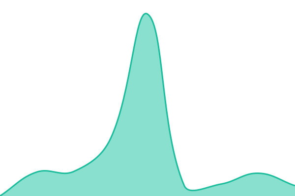

# JackYun Status 2.0.0

[服务状态](https://status.jackyun.top) · [主站](https://jackyun.top) · [故障记录](https://github.com/YunfanShi/jackyun-status/issues)

独立静态状态页：总体运行情况、两个真实监控服务、90 天故障记录、近 30 天可用率、历史故障和维护公告。保留 Upptime 历史与监控，不依赖访客的 GitHub API 额度，也不要求填写 Token。

## 状态与数据口径

- 最新状态由发布任务实际 GET 两个公开监控地址确认；应用与数据库接口还需 JSON 的 status 为 ok。非成功响应或连接失败表示中断，成功响应超过 5000 ms 表示响应较慢。
- 页面每分钟读取同域 status.json，约每 5 分钟生成快照；Actions 调度可能延迟。快照超过 20 分钟、时间无效、数据读取失败或离线时，停止宣称全部正常。
- 近 30 天可用率与每日故障分钟沿用 history/summary.json。90 天中监控开始前显示灰色，没有故障记录的日期显示绿色，存在故障分钟的日期显示红色。当天尚未结束，历史汇总每天更新。
- 故障与维护来源于 GitHub Issues，发布时分页读取；maintenance 标签代表维护，打开状态显示计划中或进行中的维护。读取失败显示未确认，并保留仓库中最后保存的公开记录。
- 订阅入口进入 GitHub Issues；通过 Watch 接收通知，需要 GitHub 账号。当前未实现独立邮件订阅。
- 浏览器时间采用用户本机时区，日期条采用 UTC。监控为单一 Actions 探测点，不代表所有地区及每位用户的体验。

## 本地开发与发布

Node 22 或更高，无第三方运行依赖。运行 node --test、node scripts/build.mjs、node scripts/serve.mjs 可离线预览；离线构建明确显示未确认状态。设置 STATUS_LIVE_PROBE=1 和 STATUS_FETCH_ISSUES=1 获取真实状态。GitHub API 凭证仅供构建任务使用，不输出到页面。

main 是唯一开发主线；Status Website 工作流测试、生成最新快照，并通过 GitHub Pages 官方 Actions 发布到 status.jackyun.top。保留旧 gh-pages 内容供回退。停止自动覆盖自定义网站的 Upptime 模板更新流程，保留 Uptime、Response Time、Summary 和 Graphs 工作流。原模板版本 v1.45.1 为监控依赖版本；网站项目新版本 2.0.0 为完整重做。

详细任务说明和截图见 docs 目录。回退时将 Pages 发布模式改回旧 gh-pages 分支，并恢复旧工作流；无需删除历史故障。

## Upptime 自动监控摘要

<!--live status--> **所有服务运行正常**

<!--start: status pages-->
<!-- This summary is generated by Upptime (https://github.com/upptime/upptime) -->
<!-- Do not edit this manually, your changes will be overwritten -->
<!-- prettier-ignore -->
| URL | Status | History | Response Time | Uptime |
| --- | ------ | ------- | ------------- | ------ |
|  [JackYun Portal](https://jackyun.top) | 正常 | [jack-yun-portal.yml](https://github.com/YunfanShi/jackyun-status/commits/HEAD/history/jack-yun-portal.yml) | 

 2965毫秒
     
 | 

<a href="https://status.jackyun.top/history/jack-yun-portal">98.33%</a>
    

|  [应用与数据库](https://jackyun.top/api/health) | 正常 | [应用与数据库.yml](https://github.com/YunfanShi/jackyun-status/commits/HEAD/history/应用与数据库.yml) | 

 1650毫秒
     
 | 

<a href="https://status.jackyun.top/history/应用与数据库">98.33%</a>
    

<!--end: status pages-->

## License

网站代码沿用 MIT 许可证。Upptime 原作者及版权信息保留于 LICENSE。history 数据沿用 Open Database License。
